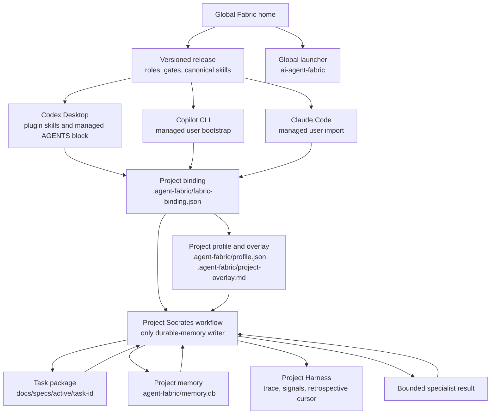

# AI Agent Fabric

Portable, project-local infrastructure for AI-agent teams. It provides a versioned
user-level runtime with shared roles, durable task state, bounded delegation, and
evidence-based workflow gates. Every target repository binds to one Fabric release and
keeps its own profile, tasks, memory, Harness data, and integration settings.

Fabric is not a global project database or a replacement for a team's tracker. One
project never reads another project's task state, memory, or retrospective signals.

## At a glance

```text
user request
  -> project context and local task state
  -> Socrates coordinates a bounded specialist task
  -> specialist returns a typed result
  -> Socrates records evidence and advances the next gate
  -> review, validation, archive, and later safe restore
```

The release supplies the common protocol. A bound project supplies only its own facts:
requirements, profile, enabled capabilities, integrations, and task artifacts.

## Roles

The selected release owns the canonical, machine-readable role profiles; their readable
companions are in [`docs/agents`](docs/agents/README.md).

| Role | Persona | Responsibility |
| --- | --- | --- |
| Orchestrator | Socrates | Owns task state, delegates bounded work, records durable evidence, and decides the next gate. |
| Explore | Aristotle | Establishes evidence, usage maps, dependencies, and conflicts. |
| Plan | Plato | Produces a scoped implementation and validation plan from current evidence. |
| Opponent | Kepler | Challenges evidence and plans without silently expanding scope. |
| Dev | Heracles | Implements approved, bounded changes. |
| Review | Athena | Reviews changed work against acceptance criteria and evidence. |
| Validation | Euclid | Validates enabled project contracts and assertions. |

Socrates is the sole durable-memory writer. Specialists receive a bounded delegation
contract and return typed findings and artifact references; Socrates persists and
acknowledges the result in the project-local store. That gives a single ordered audit
trail and permits safe recovery after interruption.

## Architecture and boundaries

```text
AI Agent Fabric release                         bound target repository
------------------------                         -------------------------
roles + gates + adapters  ---- release binding -> .agent-fabric/profile.json
global launcher            ---- commands ------> docs/specs/ task packages
                                                    .agent-fabric/memory.db
                                                    .agent-fabric/harness/
```

The core contains no client identifiers, credentials, machine paths, services, tracker
rules, or target-repository facts. Those belong only to the target's local profile and
selected adapter. See [architecture](docs/architecture.md) and
[project profiles](docs/project-profile.md).

### Global-to-project configuration flow



The diagram shows ownership as well as loading: global release files are reusable, but
the binding selects one release for one project. Task packages, memory, and Harness data
remain project-local; a client plugin or bootstrap never makes them global.

## Install and bind a project

From a development checkout, preview every write first:

```bash
python scripts/run-fabric.py distribution install-release . --preview
python scripts/run-fabric.py distribution install-release .

python scripts/run-fabric.py distribution enable-client codex --preview
python scripts/run-fabric.py distribution enable-client codex
```

After installation, use the global launcher. Merely opening a repository never creates
Fabric state:

```bash
# Read-only discovery
ai-agent-fabric project status /path/to/project --json

# Explicit preview before binding a project
ai-agent-fabric project init /path/to/project --client codex --preview
```

Fabric detects the host, Bash, Python, Git, and selected client before choosing a
declared project command. On Windows, a detected Git Bash is preferred over a WSL shim.
See [global distribution](docs/global-distribution.md) and
[project onboarding](docs/project-onboarding.md).

## Client delivery: bootstraps and skills

Fabric keeps one canonical copy of its reusable workflow skills in the installed
Fabric home:

```text
<fabric-home>/
  skills/
    work/SKILL.md       # route one project to restore or new-task intake
    start/SKILL.md      # preview and create a task package
    restore/SKILL.md    # read task context without restarting work
    harness/SKILL.md    # review project-local behavioural signals
  adapters/<client>/bootstrap.md
```

The client never receives a copy of a project's memory, task package, credentials, or
profile in its skill installation. Those remain below the bound repository's
`.agent-fabric/` directory and `docs/specs/`.

| Client | User-level bootstrap | How Fabric skills are delivered | Project layer |
| --- | --- | --- | --- |
| Codex Desktop | Managed Fabric block in `~/.codex/AGENTS.md`. | The Codex plugin package ships the Fabric skills and exposes them under the plugin namespace, for example `$agent-fabric:agent-fabric-work`. The plugin installation is the normal delivery path; it does not require direct links in `~/.codex/skills`. | The bootstrap reads `.agent-fabric/fabric-binding.json` and `.agent-fabric/project-overlay.md`. Repository `AGENTS.md` remains project-owned. |
| GitHub Copilot CLI | Managed Fabric block in `~/.copilot/copilot-instructions.md`. | The bootstrap points at the canonical Fabric release and launcher. The baseline does not copy Fabric skills into a repository or install a separate Copilot skill directory. | The same binding and project overlay; existing `.github/copilot-instructions.md`, `.github/instructions/`, and `.github/agents/` remain project-owned. |
| Claude Code (Anthropic) | `~/.claude/CLAUDE.md` imports the Fabric bootstrap from the installed release. | The bootstrap points at the canonical Fabric release and launcher. The baseline does not copy Fabric skills into a repository or install a separate Claude skill directory. | The same binding and project overlay; existing `CLAUDE.md` and `.claude/` files remain project-owned. |

### Examples

**Codex Desktop** loads the plugin-provided task router directly in a conversation:

```text
$agent-fabric:agent-fabric-work
```

The skill reads the bound project's context and invokes the global launcher. It does
not carry task state inside the plugin cache.

**Copilot CLI** and **Claude Code** load their user-level bootstrap first, then the
bootstrap discovers the bound project. In both cases the portable CLI remains the
source of truth:

```bash
ai-agent-fabric work /path/to/project --json
ai-agent-fabric restore /path/to/project <task-id> --json
```

Loading differs by client: Codex uses ordered global-then-repository instructions,
Copilot combines applicable instruction files, and Claude treats applicable `CLAUDE.md`
layers as additive. Fabric's managed block is installed, backed up, rolled back, and
uninstalled only through the selected adapter lifecycle; it never replaces a user-owned
instruction file. Current baseline adapters declare no automatic lifecycle hook.

## Commands and entry points

All state-changing commands require a bound project. The installed launcher exposes
these command groups:

| Need | Command | What it does |
| --- | --- | --- |
| Inspect a project | `project status <project> --json` | Read-only binding and release status. |
| Enter work | `work <project> [task-id] --json` | Read-only router: restores one task, starts intake, or asks for a task choice. |
| Start a task | `start <project> --title "..." --type planned --json` | Previews a task package; `--apply` creates it only after approval. |
| Restore task context | `restore <project> <task-id> --json` | Reads task metadata, artifacts, local memory, and pending delegation results. |
| Inspect the host | `detect --json` | Read-only capability report. |
| Inspect Harness | `harness health <project> --json` | Read-only health report for local state and pinned release. |

Use `ai-agent-fabric --help` or a command's `--help` for the exact arguments. The
development wrapper `python scripts/run-fabric.py` builds or inspects a release; bound
projects use the global launcher instead.

## Tasks, memory, and recovery

Fabric deliberately keeps three recovery surfaces separate:

```text
work router                 task package                 local memory
-----------                 ------------                 ------------
choose one task       ->    spec / plan / evidence   ->  session + records
or new-task intake          checklist / session state      requests + result outbox
        |                           |                            |
        +---------------------------+----------------------------+
                                    |
                                    v
                         Socrates decides the next safe action
```

### Task packages

Planned work has a package under `docs/specs/active/<task-id>/` containing a spec,
research, plan, Kepler verdict, task list, evidence, and session state. Small bugs use
a lighter package. A completed step identifies evidence; a skipped step identifies its
reason. A task package is the durable, reviewable source of scope.

### Project-local memory

Each bound project stores its episodic state in `.agent-fabric/memory.db`. It contains
orchestrator sessions, non-secret evidence records, bounded delegation requests, and
the specialist-result outbox. It is never shared with another project or the global
Fabric release.

Socrates starts or reactivates a task session, records decisions and evidence, queues a
delegation request, and acknowledges completed specialist results. The public memory
commands reflect those stages:

```bash
ai-agent-fabric memory start-session /path/to/project \
  --session <task-id> --title "Short task title"

ai-agent-fabric memory restore /path/to/project --session <task-id> --json
ai-agent-fabric memory pending-requests /path/to/project --session <task-id> --json
ai-agent-fabric memory pending-results /path/to/project --session <task-id> --json
```

Memory stores identifiers and typed, non-secret evidence. Detailed findings remain in
the task artifacts; credentials are never recorded in memory, task packages, commands,
or Harness logs.

### What “restore” means

| Command | Restores or reads | Does not do |
| --- | --- | --- |
| `work <project>` | Routes to one active task or new-task intake. | Start implementation or mutate state. |
| `restore <project> <task-id>` | Task artifacts, local session context, and pending delegation results. | Run a project command, edit files, or advance a task. |
| `memory restore <project> --session <task-id>` | The memory record for one orchestrator session. | Change the session. |
| `harness resume <project>` | A read-only snapshot of Fabric task and Harness context. | Start services, contact trackers, or change state. |

This distinction is intentional: a recovery command can reconstruct context after a
crash without silently resuming execution. Socrates reads the restored state, identifies
the first unfinished safe step, and waits for the applicable workflow direction.

## Delegation and the lifecycle

```text
Socrates creates a request
  -> specialist reads declared task artifacts
  -> specialist returns a typed result to Socrates
  -> Socrates records evidence and acknowledges the result
  -> immutable gate checks the required evidence labels
  -> Socrates chooses the next bounded action
```

Delegation payloads reference project-relative artifacts rather than duplicating a
mutable prompt. They reject secret-like keys and common credential formats. Pending
results have idempotency keys, so an interruption cannot silently duplicate a durable
record. See the [delegation contract](docs/delegation.md), [memory boundary](docs/memory.md),
and [gates](docs/gates.md).

## Workflow and approvals

```text
new request
  -> work router
  -> local correction | small bug | planned work
                                  -> spec -> research -> plan
                                                 -> Kepler verdict
                                                 -> human approval
                                                 -> scoped implementation
                                                 -> Athena review -> validation
                                                 -> evidence and archive
```

For planned work, Aristotle establishes evidence, Plato creates the bounded plan, and
Kepler independently challenges it. Heracles implements only approved scope. Athena
reviews changed work; Euclid validates only when the project enables that capability.
Read the [portable workflow](docs/workflow.md) and [task specifications](docs/task-specs.md).

## Harness: learning from agent friction

Harness is a project-local retrospective loop, not automatic self-modification. It
stores minimal, identifier-only audit data under `.agent-fabric/harness/`:

```text
trace.jsonl                 gate/checkpoint audit events
signals.jsonl               behavioural signals, never chat transcripts
retrospective-state.json    immutable watermark of the last approved review
```

```text
Socrates records a bounded signal
  -> retrospective input since the last approved watermark
  -> evidence-backed report
  -> Kepler review
  -> human accepts, rejects, or defers proposals
  -> close retrospective advances the local cursor
```

Relevant categories include `user-correction`, `missed-instruction`,
`scope-violation`, `memory-gap`, `repeated-failure`, and `friction`. A signal is a lead,
not proof; the task artifact provides the evidence.

```bash
ai-agent-fabric harness signal /path/to/project \
  --category user-correction --task-id <task-id> \
  --artifact docs/specs/active/<task-id>/evidence/feedback.md

ai-agent-fabric harness review /path/to/project --json
```

Client lifecycle hooks are adapter-owned. When an adapter has no installed hook,
Fabric does not claim to read private chat history or capture corrections automatically:
the configured Socrates workflow invokes the explicit command. See [Harness](docs/harness.md).

## Current status

The core adaptation and Windows/Git-Bash validation are recorded in this repository.
WSL, native Linux, and unavailable client-delivery variants remain explicit unverified
or unsupported rows rather than implied support. See the
[validation matrix](docs/validation-matrix.md).

The current release defines Socrates as the orchestration role and durable-memory
writer. A distinct, client-launched per-project Socrates entrypoint is planned work,
not an existing command; the README does not represent it as already delivered.

## Development

The isolated test suite is run as a validation activity:

```bash
python scripts/run-tests.py
```

Before changing the runtime, read [AGENTS.md](AGENTS.md), then
[architecture](docs/architecture.md) and [project profile](docs/project-profile.md).

## Documentation map

- [Architecture](docs/architecture.md)
- [Agent profiles](docs/agents/README.md)
- [Workflow](docs/workflow.md)
- [Memory boundary](docs/memory.md)
- [Delegation](docs/delegation.md)
- [Harness](docs/harness.md)
- [Gates](docs/gates.md)
- [Client adapters](docs/agent-clients.md)
- [Global distribution](docs/global-distribution.md)
- [Security and secret entry](docs/security/secret-entry.md)
