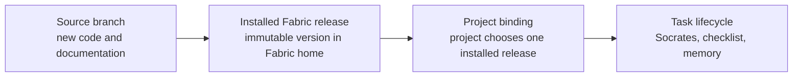
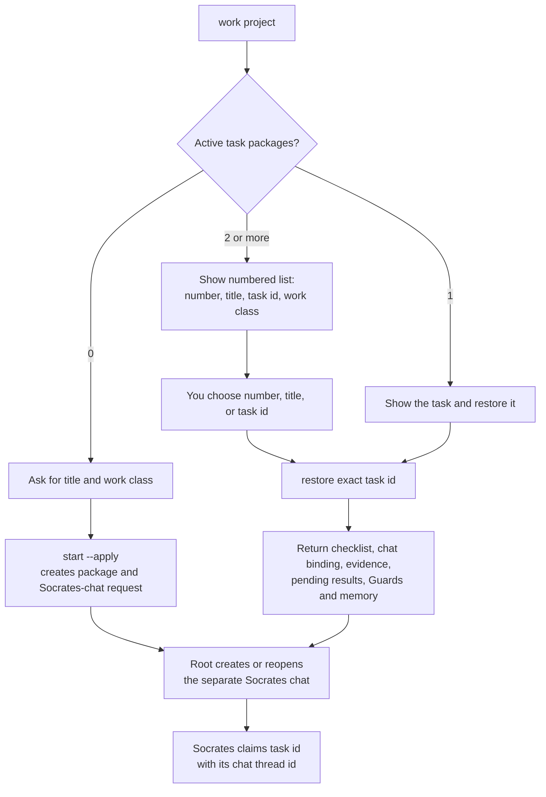
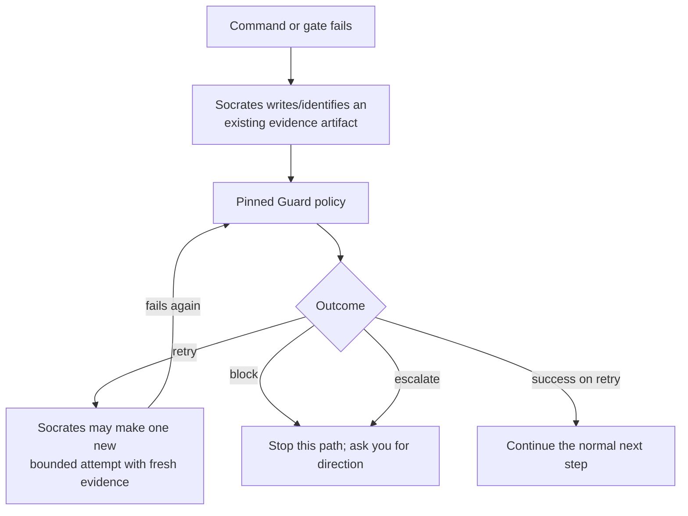
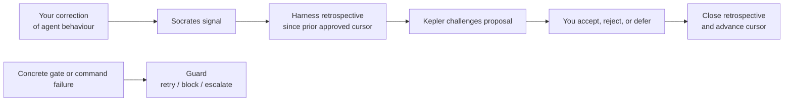
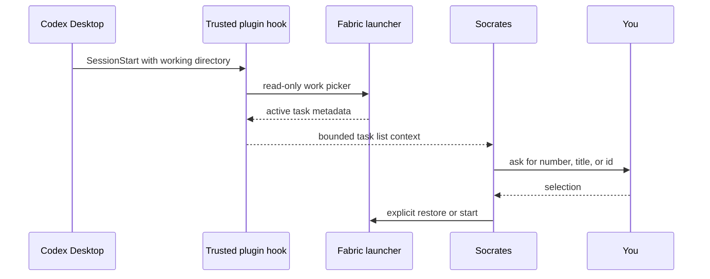

# Using Fabric in a project

This is the operator guide for a person using a bound project through Codex, Copilot,
or Claude. It describes what the task commands do, who decides after a failure, and
when Fabric behaviour is actually live.

If `start` or `restore` fails in Codex, Root stops project work. It may only report
the failure or run the explicit Fabric recovery path; it must not execute the task in
place of the task-local Socrates lifecycle.

## The three states that must not be confused

Changing or pushing a source branch does not change an installed release. Installing a
release does not change existing projects. A project begins using a release only after
its binding is explicitly updated. Use `project context <project> --json` to see the
release currently selected by that project; use the installer preview before any
installation or binding update.

## Starting or returning to work

In a client conversation, ask to work on the project. The Fabric work skill runs the
read-only router first. If you specifically ask to restore but do not remember a task,
`restore <project> --json` itself returns the same numbered picker and makes no change.

You do not need to remember ids. `restore` without an argument shows every active task
as a numbered list. You can answer with that number, the exact title, or the task id;
the launcher resolves it to the durable id before restoring. The conversational number
is only a convenient selection label.

Saying or typing the ordinary word `start` is not an operating-system action. A task
starts only when the Fabric skill invokes `start ... --apply`. This is intentional: it
prevents a casual sentence from creating project state.

`start --apply` does not prove that Socrates is live. It creates a pending chat claim.
Root creates the separate Socrates chat, delivers the returned activation packet, and
does not continue the task. `restore` does not execute the next step or run a project
command. It reconstructs the chosen task packet and returns the bound chat id when one
exists, so Root can reopen that exact chat. Socrates claims the task and then reads its
`next_action` before doing work. A completed checklist step remains completed; a
missing memory database is reported as a recovery problem rather than recreated as an
empty task.

## What Socrates is

Socrates is the project-local orchestration role, not a background daemon. A task has
one durable Socrates lifecycle in its project-local memory and one visible, claimed
Socrates chat. It owns task transitions, delegation records, Guard outcomes, and
Harness signals. Specialists return bounded results and evidence artifacts; they do
not choose retry policy or persist project memory. Root opens that chat and remains an
entry/recovery coordinator; it is not Socrates and must not create specialist chats.

## Guards: what happens after an error

A Guard is a deterministic response to a concrete, evidenced technical failure. It is
not a pop-up asking you to approve every error and it never reruns a command by itself.

The baseline policies are:

| Failure kind | Outcome | Who acts next |
| --- | --- | --- |
| Failed checkpoint/gate | `block` immediately | You decide whether to supply missing evidence, change scope, or stop. |
| Failed bounded command, attempts 1–2 | `retry` | Socrates may make the next bounded attempt; it reports the result and records fresh evidence. |
| Failed bounded command, attempt 3 | `escalate` | You decide how to proceed; Socrates must stop retrying. |

So you are not interrupted for a normal first retry. You are explicitly asked when the
policy says `block` or `escalate`, or whenever the next attempt would require a new
scope, authority, or external action.

## Harness signals are not Guards

Use a Harness signal when the issue is agent behaviour rather than an execution failure:
for example, “you ignored my instruction”, “you used the wrong project”, or “you kept
repeating a mistake”. Socrates records only a category, task id, and optional evidence
artifact—not the chat transcript.

A signal is written at the time Socrates records it. A Harness *result* arrives only
when a retrospective is run: it groups the signals since the last approved cursor,
collects evidence, and produces a proposal for Kepler and you. Nothing changes
automatically.

## Hooks: what is automatic, and what is not

The Fabric Codex plugin now includes one deliberately narrow, trusted `SessionStart`
hook. Once the plugin version is installed and trusted in Codex, it finds a bound
project from the session working directory and asks the installed launcher for the
read-only active-task list. It returns that list as context so Socrates can ask you to
select a task. It does **not** start or restore a task, execute a project command,
read a transcript, or write a signal.

Codex treats command hooks as executable plugin code. You must review and trust it in
the client hook UI before it runs; Fabric does not bypass that consent. The installation
preview shows the marketplace source and the hook file that will be replaced.

No lifecycle hook automatically turns a correction into a Harness signal. That would
require copying or classifying private conversation text. When you correct behaviour,
Socrates records the explicit minimal `user-correction` signal; when a command or gate
fails, Socrates records the separate evidenced Guard failure. The hook merely makes
task selection available at session start.

### Client support boundary

| Surface | Fabric hook status | Why |
| --- | --- | --- |
| Codex Desktop/local plugin | Implemented: trusted plugin `SessionStart`, read-only picker. | Codex plugin hooks can return bounded session context after the user trusts their current hash. |
| GitHub Copilot CLI | Vendor hooks exist, but no Fabric hook is installed. | Its project/user hook configuration is a separate Copilot-owned surface; Fabric does not silently create `.github/hooks` in every project. |
| GitHub Copilot cloud agent | No Fabric local-Socrates hook. | Cloud hooks run in an ephemeral Linux job and only use repository files from the default branch; they cannot safely reach the user's local Fabric release or project-local memory. |
| Codex Cloud orchestration | No Fabric local command hook. | Local/plugin command hooks are not run by Cloud orchestration. |

The Copilot and Cloud entries are explicit limitations, not claims that the vendors lack
hooks. A future Copilot project integration must be previewed, committed to that
project's default branch, and use a cloud-safe task-state design rather than silently
reaching into a developer machine.

See [Guards](guards.md), [Harness](harness.md), and [the workflow](workflow.md) for the
underlying contracts.
